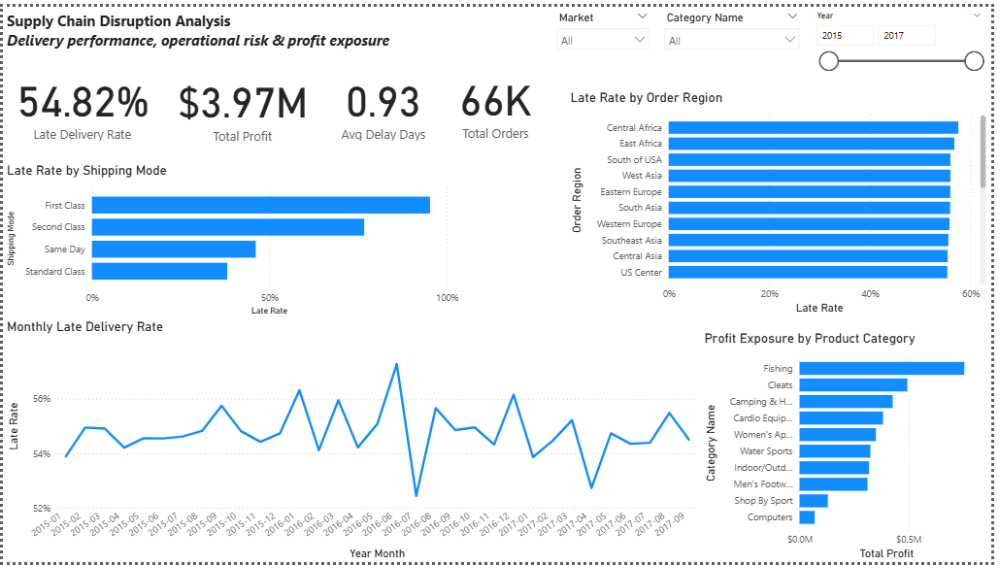
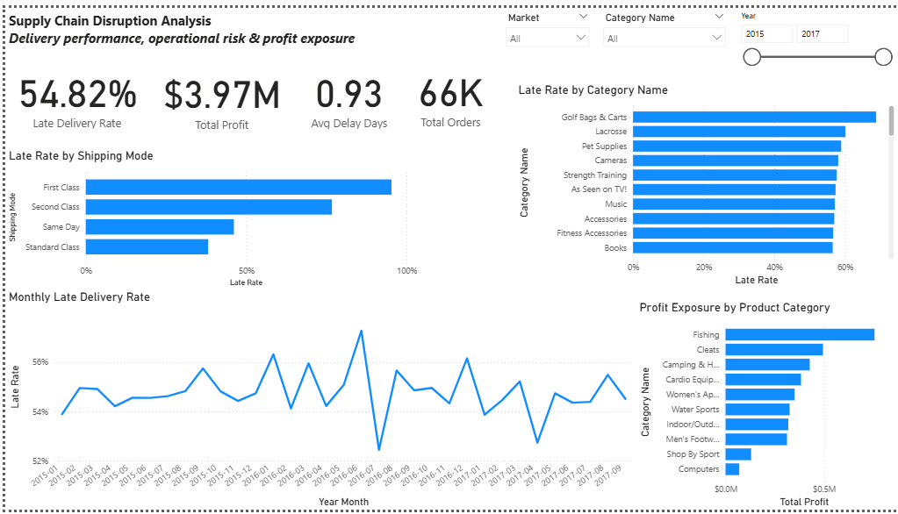

# Supply Chain Disruption Analysis

## Business Question

A CPG company is missing delivery promises. Which regions, shipping modes, and product categories are associated with late deliveries and profit exposure, and where should the team investigate first?

## Answer in Brief

**Investigate shipping mode first.** First Class and Second Class orders are late 95.3% and 76.7% of the time, compared with 38.1% for Standard Class. Together they make up about 35% of orders but about 54% of all late orders. Regions and product categories show much smaller differences in late-delivery rate.

## Project Overview

This project analyzes the DataCo Smart Supply Chain dataset to understand delivery performance, operational risk, and profit exposure. SQL was used to explore the data and run the analysis (including window functions), and Power BI was used to model the data and build an interactive dashboard for business users.

## Dashboard

**Main Dashboard**



**Drill-down Analysis**



A PDF export of the dashboard is available in `[folder name]` for viewers without Power BI.

## Tech Stack

- SQL / MySQL
- Power BI
- Power Query
- DAX
- Dimensional modeling

## Approach

1. **Kept the raw data untouched** and worked from a cleaned copy.
2. **Cleaned in Power Query:** removed columns that were mostly empty or not needed for the analysis (see Data Quality below).
3. **Explored and analyzed in SQL:** overall performance, late rate by region and shipping mode, product category risk and profitability, and a window-function ranking of regions within each category.
4. **Modeled in Power BI:** built a dimensional model and DAX measures for the dashboard.
5. **Built the dashboard** with Market, Category and Year filters and a Region → Category drill-down.

**Data pipeline:** Raw CSV → Power Query cleaning → Cleaned analytical dataset → Semantic model → DAX measures → Power BI dashboard

**A note on grain:** the dataset has 180,519 rows, but each row is an order *item*, and there are only 65,752 distinct orders. Order-level metrics (such as late-delivery rate) use `COUNT(DISTINCT Order Id)`. Item-level metrics (such as category late items and profit per item) use order items.

## Key Findings

### Overall
- 65,752 distinct orders were analyzed, with **36,048 late orders (54.82%)**.
- Total recorded order profit was approximately **$3.97M**.
- Average actual shipping time was **3.50 days** against **2.93 days** scheduled.

### Shipping mode shows the largest difference
| Shipping mode | Orders | Late orders | Late rate | Total profit |
|---|---|---|---|---|
| First Class | 10,079 | 9,602 | 95.27% | $643,121.92 |
| Second Class | 12,778 | 9,803 | 76.72% | $750,308.17 |
| Same Day | 3,571 | 1,648 | 46.15% | $203,018.43 |
| Standard Class | 39,324 | 14,995 | 38.13% | $2,370,454.45 |

- First Class and Second Class together account for about 35% of orders, about 54% of late orders (19,405 of 36,048), and about 35% of profit (about $1.39M).
- The pattern holds inside every region: First Class is late 91% to 100% of the time in all regions, while Standard Class ranges from about 32% to 43%.

### Regions differ only modestly
- Regional late rates range from **49.51% (Canada, 309 orders)** to **57.55% (Central Africa, 556 orders)**, a spread of about 8 points.
- The largest regions by volume are close to the average: Western Europe (10,010 orders, 55.79% late, about $625K profit) and Central America (9,396 orders, 54.87% late, about $616K profit).
- Because the spread is narrow, regional fixes are unlikely to move the overall late rate as much as shipping mode.

### Categories: volume, not a category-specific problem
- High-volume categories account for the most late items simply because they have the most orders: Cleats (24,551 items, 13,496 late), Men's Footwear (22,246 items, 12,121 late), Women's Apparel (21,035 items, 11,476 late), and Fishing (17,325 items, 9,516 late, about $756K profit).
- Their late rates are nearly identical (about 54.5% to 55.0%), so no single high-volume category stands out as worse than the rest.
- Some low-volume categories show very high late rates (for example, Golf Bags & Carts at 68.85%) but only on 61 items, so they are not used for recommendations.

### Profit
- Late items show slightly lower average profit per item (**$21.62 vs $22.40**) and profit margin (**10.63% vs 10.97%**) than non-late items.
- The gap is small, so it suggests delivery performance should be monitored alongside margin, not that late delivery is a major driver of lost profit.

> These findings describe associations in the dataset and do not establish causality.

## Recommendations: Where to Investigate First

1. **Shipping mode, starting with First Class and Second Class.** These modes are late 95.3% and 76.7% of the time and account for about 54% of all late orders. A first step is to check whether the promised delivery windows for these modes are realistic. This is a hypothesis to test, not a conclusion from this data.
2. **High-volume categories (Cleats, Men's Footwear, Women's Apparel, Fishing).** Late rates are similar across categories, so the priority is the number of orders affected rather than any one category.
3. **Regions are a lower priority.** Late rates vary by only about 8 points across regions.

## Data Quality

- 180,519 records and 53 columns at the start
- 0 duplicate rows
- 0 duplicate Order Item IDs
- 155,679 missing Order Zipcodes (column removed)
- 3 missing Customer Zipcodes (column removed, not needed for regional analysis)
- 8 missing Customer Last Names (column removed, not needed for analysis)
- 0 negative actual shipping durations
- 4,423 differences between the calculated shipping-delay indicator and the provided `Late_delivery_risk` flag

The provided `Late_delivery_risk` field was retained as the governed definition for late orders.

## Limitations

- Results show associations, not causes. The dataset does not explain why orders were late.
- Small groups can give misleading rates. Many category-by-region combinations have only 1 to 10 order items, so the category-region ranking query is mainly a demonstration of the SQL technique. Dashboard recommendations should filter out groups below a minimum sample size.
- The late definition depends on the provided `Late_delivery_risk` flag, which differs from the calculated indicator in 4,423 cases.

## Dashboard Features

- KPI summary
- Regional delivery risk
- Shipping-mode comparison
- Monthly delivery trend
- Product-category profit exposure
- Interactive Market, Category and Year filters
- Region → Category drill-down

## Repository Structure

```
[TODO: match this to your actual repo]
├── data/            # raw (untouched) and cleaned copies
├── sql/             # SQL queries used in the analysis
├── powerbi/         # .pbix file and PDF export
├── images/          # dashboard screenshots
└── README.md
```

## How to Reproduce

1. Download the DataCo Smart Supply Chain dataset and keep the original file unchanged.
2. Apply the Power Query cleaning steps described above to create the cleaned dataset.
3. Run the SQL queries in the `sql/` folder against the cleaned data in MySQL.
4. Open the Power BI file and refresh the data source to point to your local copy.


